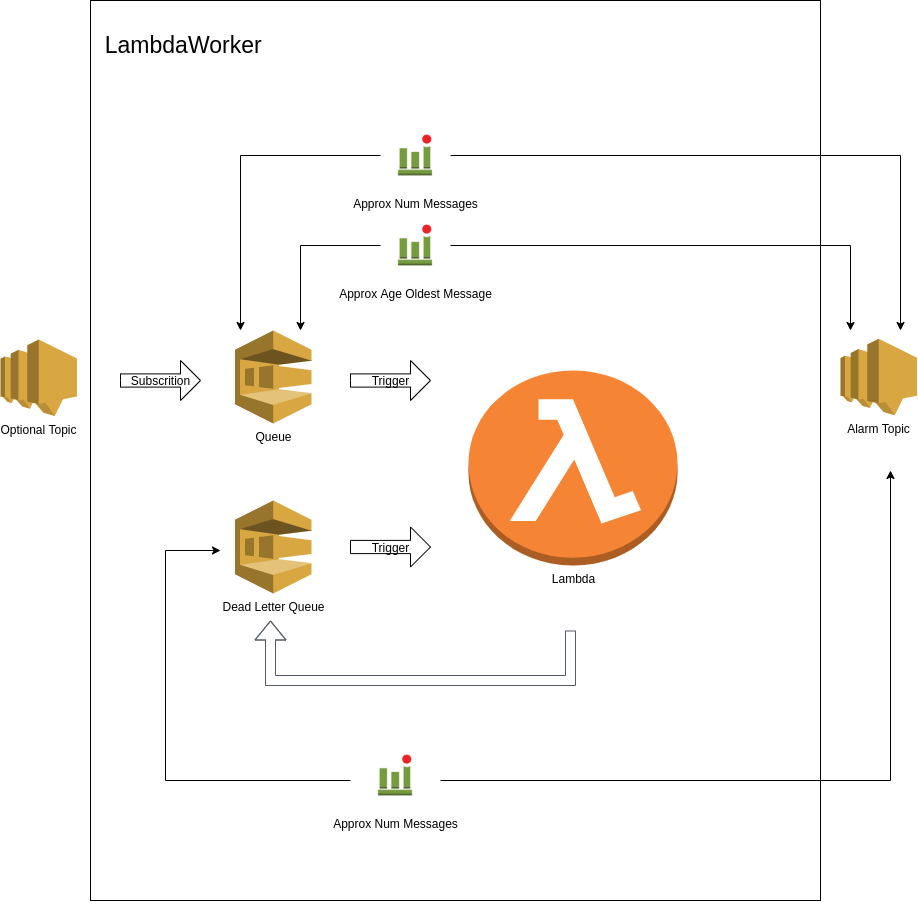

# LambdaWorker Example: SimpleLambdaWorker

This is an example of using the LambdaWorker in a simple worker.

The LambdaWorker:

- is subscribed to an SQS queue whose trigger is enabled by default
- sends failed jobs to another SQS queue - a dead letter queue
- is subscribed to the dead letter queue but this trigger is disabled by default
- allows for the replay of failed jobs with the talis-cli tools awsdlq tool
- triggers an alarm for failed jobs
- triggers an alarm when the queue of jobs exceeds a configuarble maximum threshold
- triggers an alarm when a message waiting on the queue is older than a configurable maximum

Optionionally, the LambdaWorker:

- can have its SQS queue subscribed to an SNS topic.
  - For example all Depot workers subscribe to a "File" topic in a Pub/Sub architecture.
- can have a filterPolicy specified so that it only receives messages from the SNS topic which it is interested in.

Permissions can be granted after the LambdaWorker is created, and apply to the lambda of every fallback tier too:

```ts
bucket.grantRead(worker);
worker.lambdaQueue.grantSendMessages(worker);
```

## Construct Diagram



## Note:

The `talis-cli-tools` `awsdlq` tool can be used to replay messages.
See the tech team talk on the `awsdlq` [here](https://docs.google.com/presentation/d/1ND9LMPBeMFqqoxCfsh3Z57Gl0N8JnA9XjZGmqYgTo_A).

## This Example

To build and deploy this example:

- `export AWS_PREFIX=development-XX-` where XX are your initials
  - This is used in the name of the stack and resources created, so that they do not clash with anyone elses stack in AWS
- `source awsenv <profile>` to set your credentials to the shared account
- `npm ci` in the repository root (examples share its dependencies and run straight from TypeScript via `tsx`)
- `npx cdk deploy`

After you have finished with the example, remove your stack in AWS using:

- `npx cdk destroy`

## Useful commands

- `npx cdk deploy` deploy this stack to your default AWS account/region
- `npx cdk diff` compare deployed stack with current state
- `npx cdk synth` emits the synthesized CloudFormation template
